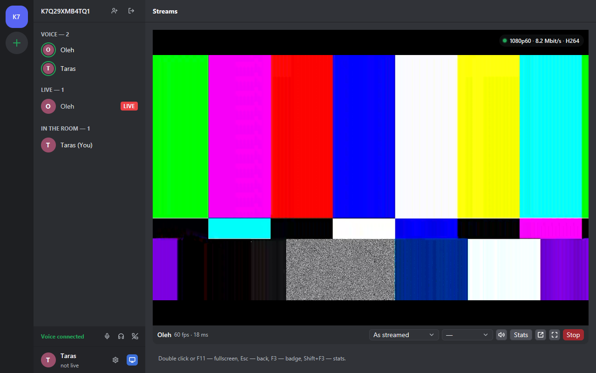
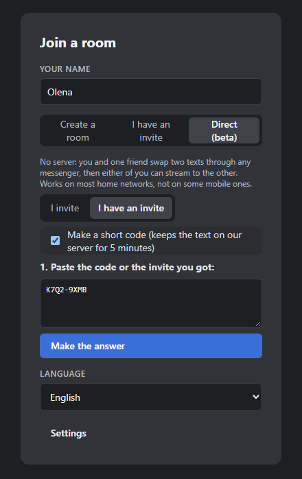

<p align="center">
  
</p>

<h1 align="center">Backseat</h1>

<p align="center">
  Stream your game to friends, straight from your PC to theirs.<br>
  Low latency, hardware encoding, no media server.
</p>

<p align="center">
  <b>English</b> · <a href="README.uk.md">Українська</a> · <a href="README.ru.md">Русский</a>
</p>

<p align="center">
  <a href="../../releases/latest"><b>Download for Windows</b></a>
</p>



## What it is

Backseat is a Windows app for watching each other play. It looks and feels like a small
Discord server: rooms on the left, the people in the open room, and their streams in the
middle. Anyone in a room can go live, and anyone can watch, several streams at once.

The video goes **directly** from the streamer's computer to each viewer. Nothing in
between stores or re-encodes it, which keeps the delay low (tens of milliseconds on a
good connection) and the picture as sharp as your upload allows.

## Features

- **Rooms by invite.** Create a room, send the invite link or code. Only people with the
  invite get in. Your rooms stay in the list on the left.
- **Sharp and smooth.** 720p, 1080p or 1440p at 30 or 60 fps, 2 to 50 Mbit/s, encoded on
  your graphics card (NVIDIA, AMD or Intel) in AV1, H.265 or H.264.
- **Each viewer chooses.** Viewers can ask for less than you stream (for a slow
  connection), never more. One viewer's slow internet never slows the others down.
- **A screen or one window**, with all sound, only that program's sound, or none.
- **Change the stream while live:** another window, resolution, frame rate or bitrate, and
  nobody has to reconnect.
- **Comfortable to watch:** video inside the app or in its own window, fullscreen,
  volume and mute right on the video, stats with F3.
- **Stays out of the way:** closing the window keeps Backseat in the tray. It updates
  itself.
- **Direct connection (beta):** two people can connect with no server at all (see below).
- In **English, Ukrainian and Russian**.

## Get started

1. Download `backseat-setup-X.Y.Z.exe` from [Releases](../../releases/latest) and run it.
   It installs for your Windows user only, no administrator rights needed.
   Windows SmartScreen may warn that the installer is not signed: choose
   *More info → Run anyway*.
2. Start Backseat and pick how to connect:
   - **A room on a signaling server** (the usual way, any number of people), or
   - **Direct (beta)**, for two people without any server.

### Rooms

A room needs a **signaling server**: a tiny service that tells the people in a room about
each other. No video goes through it. You can [run your own](#run-a-signaling-server) in a
few minutes, for free, or use one a friend runs.

1. Enter the server address (like `wss://your-server.example.com/ws`) in
   *Settings → General*, or on the join form.
2. *Create a room*, give it a name, and press the invite button next to the room name to
   copy the invite. Send it to your friends; the link opens Backseat right in that room.
3. Press **Stream**, pick a screen or a window, and go live. Friends press **Watch**.

If the connection to the server drops for a moment, Backseat reconnects on its own and
streams go on.

### Direct connection (beta)

For two people, with no server at all. You swap two texts once, through any messenger:



1. You: *Direct (beta)* → **I invite** → *Make the invite*, and send the text to your
   friend.
2. Your friend: *Direct (beta)* → **I have an invite**, pastes it, presses
   *Make the answer* and sends that text back.
3. You paste the answer and press *Connect*. Done: either of you can now go live and the
   other can watch, both at once too.

Instead of each long text, Backseat also shows a **short code** like `K7Q2-9XMB` that
works for 5 minutes; send whichever is easier, the other side pastes it the same way.
For those 5 minutes the text is kept on a small server; untick *Make a short code* to
use only the full texts. When that server does not answer, you just get the full text.

Good to know before you use it:

- **Only two people.** For more, use a room.
- **No reconnection.** If the connection drops (Wi-Fi hiccup, sleep, a network change),
  it ends, and you swap the texts again.
- **One use.** An invite works only once, and only while the app that made it stays open.
- **The texts contain your network addresses.** Send them only to the person you want to
  connect with.
- **Some networks will not work**, mostly mobile internet and some providers' shared
  addresses (CGNAT). The same goes for rooms, since the video always goes directly
  between the two computers.
- **Nothing is saved:** a direct connection does not appear in the rooms list.

## Requirements

- Windows 10 or 11, 64-bit.
- To **stream**: a graphics card with a hardware video encoder (most NVIDIA, AMD and Intel
  cards from the last several years).
- To **watch**: any reasonably recent PC. AV1 streams are decoded on the processor when
  the graphics card cannot decode AV1.

## Tips

- **Default settings:** *Settings → Streaming* sets what the go-live dialog picks each
  time; *Settings → Watching* sets the most you want to receive (handy on slow internet:
  a 50 Mbit/s stream then comes to you at your limit right away).
- **Keys on the video:** double click or F11 for fullscreen, Esc to leave it, F3 for stats,
  the mouse wheel for volume.
- **Upload limit:** in the go-live dialog, enter your upload speed; Backseat warns when
  one more viewer would not fit.
- **Logs** for bug reports: *Settings → General → Open the log folder*
  (`%LOCALAPPDATA%\Backseat\logs`). Send the newest files with a description.

## Run a signaling server

The server is small (`crates/server` in this repository) and needs no special hardware:
it passes a few short messages per connection and no video. The same server works for
any number of rooms.

### On Render (free, no own computer needed)

1. Sign in at [render.com](https://render.com) and choose *New → Web Service*.
2. Connect this repository (or your fork of it).
3. Settings:
   - *Runtime*: Rust
   - *Build command*: `cargo build --release -p server`
   - *Start command*: `./target/release/server`
   - *Health check path*: `/live`
4. After the first deploy, add the environment variable `STREAMER_KEEP_ALIVE_URL` with
   your service address plus `/live` (for example
   `https://my-backseat.onrender.com/live`): free services sleep when idle, and this keeps
   it awake.
5. In Backseat, the server address is `wss://my-backseat.onrender.com/ws`.

### On your own computer or server

With [Rust](https://rustup.rs) installed:

```sh
cargo run --release -p server -- 0.0.0.0:7800
```

The address is then `ws://YOUR-IP:7800/ws`. To reach it from the internet, open that port
on your router, or put it behind a reverse proxy with HTTPS and use `wss://`. Hosting
platforms that set `PORT` are supported as well (the server then listens on
`0.0.0.0:$PORT`).

What the server offers: `/ws` for the app, `/live` as a health check, and `/j/CODE` for
invite links that open the app.

## Build from source

You need Rust (stable, MSVC), Visual Studio 2022 or its Build Tools with the C++
workload, GStreamer 1.28.8 (the official MSVC x86_64 installer from
<https://gstreamer.freedesktop.org/download/>, runtime and development files) and NSIS 3.

```powershell
$env:GSTREAMER_1_0_ROOT_MSVC_X86_64 = 'C:\path\to\gstreamer\1.0\msvc_x86_64\'
.\tools\bundle.ps1                     # dist\backseat: the app with the DLLs it needs
.\tools\installer.ps1                  # dist\backseat-setup-X.Y.Z.exe
```

`bundle.ps1` copies the GStreamer libraries and plugins the app uses, the Visual C++
runtime and the license texts, and fails if any DLL import does not resolve.
A build can have one server built in, with no server field in the app: pass
`-Server wss://HOST/ws` to `tools\installer.ps1`.

Releases are built by the `release` workflow in `.github/workflows` when a tag `vX.Y.Z`
is pushed, with the notes from `CHANGELOG.md`.

## License

Backseat is released under the [MIT License](LICENSE).

The Windows build ships third-party libraries next to `backseat.exe`, most notably
GStreamer and GLib under the GNU LGPL 2.1 or later (unmodified, as separate DLLs that can
be replaced). See [THIRD-PARTY.md](THIRD-PARTY.md); the license texts are installed in
the `licenses` folder.
